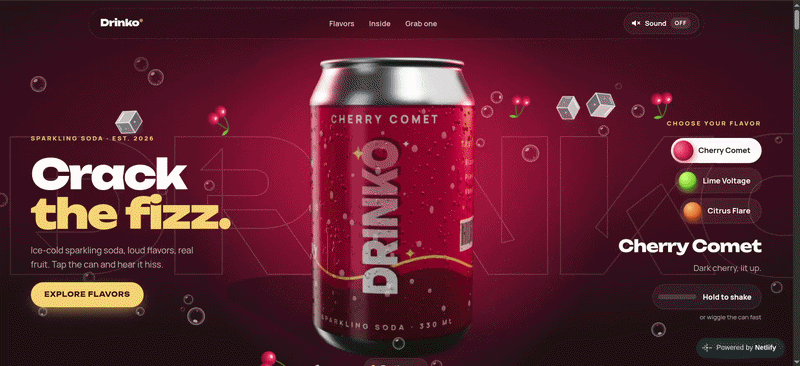

<div align="center">



<br>


**A cinematic, shoppable product site for a fictional soda brand.**
Real-time 3D, physics, scroll storytelling and a working cart, in plain HTML, CSS and JavaScript.

[Live demo](#) &nbsp;·&nbsp; [Run it locally](#running-it) &nbsp;·&nbsp; [Customize](#swapping-in-your-own-assets)

</div>

<div align="center">



</div>

## Highlights


<details>
<summary>Read the details</summary>

| | |
|---|---|
| **3D hero can** | Procedural PBR can with HDR reflections, soft shadows, drag-to-spin inertia, condensation and physically simulated splash and fizz. |
| **Shake it** | Hold, wiggle the can or physically shake your phone. Pressure builds, then the can erupts in a geyser. |
| **3D flavor carousel** | Cans on a ring over a glossy floor. Drag, tap or use arrow keys. |
| **Exploded anatomy** | A pinned scroll scene that takes the can apart, with labelled callouts. |
| **The pour** | Scroll to tip the can into a glass of ice and watch it fill, fizz and foam. |
| **Shop and cart** | Pack builder (6 / 12 / 24), flavor mixer, slide-out cart, free-shipping meter and a fly-to-cart animation. Cart persists between visits. |
| **Premium chrome** | Floating glass header with scroll progress, hide-on-scroll, active-section highlight and mobile menu. Full footer with newsletter signup. |
| **Resilient** | 2D fallback without WebGL or with reduced motion. Adaptive quality keeps frame rate near 60 on integrated GPUs. |

</details>

Also included: Lenis smooth scroll, Matter.js ice and fruit, a liquid-wipe
flavor transition, a custom cursor, magnetic buttons, film grain and a
toggleable sound design.

**Try it:** tap a can to crack it open. Drag the hero can to spin it. Double-tap,
long-press or press **R** for a 360 spin. Pick a flavor to flood the page with it.


## Running it

ES modules can't load from `file://` in Chrome, Edge or Safari, so serve the folder:

```bash
npx serve .
# or
python3 -m http.server 8000
```

Then open the printed URL. If you double-click `index.html` anyway, the loader
explains this after a few seconds. GSAP, Three.js, Lenis and Matter.js come
from CDNs, so the first load needs an internet connection.

Add `?debug` to the URL to get `window.drinko` (`hero3d`, `physics`,
`carousel`, `anatomy`, `pour`) in the console.


## Page order

Header → Hero (with **Shake it**) → scroll story → marquee → **3D flavor
carousel** → **anatomy** → ingredients → **pour** → **shop** → footer (call to
action, newsletter, links) with the cart drawer available everywhere.

In the 2D fallback, the carousel stays the flat flavor cards, the anatomy is a
list of facts, and the pour is plain copy.


## Project structure

```
index.html              Page shell + import map for Three.js
css/styles.css          All styling (2D + 3D layers, cursor, story, reduced motion)
js/config.js            Flavors, palettes, copy, asset paths, 3D / physics / story settings
js/main.js              Boot, preloading, DOM building, picks 3D vs 2D, event wiring
js/animations.js        2D GSAP animations (tap, spin, swap, bursts, scroll reveals)
js/render.js            "Your file vs generated placeholder" + 2D can DOM
js/placeholders.js      SVG generators for 2D cans, splash, ice, fruit, bubbles
js/sound.js             Toggleable sound with a synthesized fallback
js/story.js             Lenis smooth scroll + pinned ScrollTrigger story
js/sections.js          Pinned scroll timelines for the anatomy + pour sections
js/shop.js              Pack builder, cart drawer, free-shipping meter (localStorage)
js/checkout.js          3-step checkout: details, delivery, payment, confirmation
js/chrome.js            Header + footer behavior: progress bar, menu, newsletter form
js/physics.js           Matter.js ice / fruit / bubbles in the hero
js/polish.js            Liquid wipe, magnetic buttons, custom cursor, lens drips
js/loadScript.js        Lazy loader for UMD libraries
js/three/hero3d.js      Renderer, lights, camera rig, gestures, frame loop
js/three/canModel.js    Procedural lathe can or .glb loader + label morph shader
js/three/labels.js      Generated label textures + wet bump/roughness maps
js/three/particles.js   Instanced splash droplets + GPU point fizz
js/three/condensation.js Sliding condensation beads (instanced)
js/three/flyers.js      Fruit/ice fly-pasts with depth-of-field blur levels
js/three/stage.js       Base class for extra 3D sections sharing the hero's renderer
js/three/carousel.js    3D flavor carousel (ring, glossy floor, drag + snap)
js/three/anatomy.js     Exploded view + live callouts with leader lines
js/three/pour.js        Can-to-glass pour: clipped liquid, rope, ice, bubbles, foam
assets/readme/          README banner (animated SVG)
assets/                 Your files (cans, splash, fruit, decor, audio, env, models)
```


## Swapping in your own assets

Everything is configured in `js/config.js`. A path of `null` means "generate a
placeholder in code"; a string means "use this file". The animation code never
changes.

### 3D can model (.glb)

1. Put the model in `assets/models/`, e.g. `assets/models/can.glb`.
2. Set it in `SCENE_3D`:

   ```js
   export const SCENE_3D = {
     modelSrc: 'assets/models/can.glb',
     // ...
   };
   ```

Naming conventions inside the .glb:

| Name contains | What happens |
|---------------|--------------|
| `label` (mesh **or** material name) | Gets the flavor label texture and the liquid-fill morph on flavor change. Its UVs should wrap the label once around (u = 0.5 facing forward). |
| `tab` (any object) | Pops open on tap by rotating around the object's own origin on X. Put the origin at the rivet. |

The model is auto-scaled to a height of ~1 unit, centered, and stood on the
floor. If the file fails to load, the procedural can is used and the console
says why.

### Label textures (3D)

Each flavor can have its own wrap-around label image:

```js
{ id: 'cherry-comet', /* ... */ labelSrc: 'assets/labels/cherry.png' }
```

Use a ~2.4 : 1 image (e.g. 2048 × 860). The left and right edges meet at the
back of the can, and the center faces the viewer. Leave it `null` to get a
generated label in the flavor's palette.

### Reflections (HDR)

`SCENE_3D.hdrSrc` points to an equirectangular `.hdr` (the bundled one is
Poly Haven's CC0 *studio_small_09*). It is lazy-loaded after the intro. Until
then, and if it fails to load, a painted studio environment is used.

### 2D cans, splash, fruit, decor, sound

These are used by the 2D fallback and as sprites in the 3D experience:

```js
canSrc:    'assets/cans/cherry-comet.png', // 2D can art. In 3D mode the cards/footer show renders of the 3D can instead
tabSrc:    'assets/cans/tab.png',          // false = your can art already includes a tab
splashSrc: 'assets/splash/cherry-splash.png',
dropSrc:   'assets/splash/cherry-drop.png',
fruitSrc:  'assets/fruit/cherry.png',      // also used by physics + 3D fly-pasts
```

Shared images live in `DECOR` (`bubbleSrc`, `iceSrc`, also used by physics and
fly-pasts) and sounds in `SOUNDS`. All images should have transparent
backgrounds. `CAN_LAYOUT` (or a per-flavor `canLayout`) positions the 2D tab
on your can art.

### Libraries

Three.js is mapped in the import map at the top of `index.html`. Lenis and
Matter.js URLs live in `LIBS` in `config.js`.


## Adding a new flavor

Add an object to `FLAVORS` in `js/config.js`:

```js
{
  id: 'grape-galaxy',
  name: 'Grape Galaxy',
  short: 'Grape',
  tagline: 'Purple, but louder.',
  description: 'Concord grape and blackcurrant…',
  notes: ['Concord grape', 'Blackcurrant', 'Lavender'],
  palette: {
    primary: '#8b3dff', dark: '#2e0b66', highlight: '#d2b3ff', accent: '#7cf5ff',
    bgFrom: '#0b0418', bgTo: '#3b1478', ink: '#08151a',
  },
  fruit: 'cherry', // placeholder fruit drawing: 'cherry' | 'lime' | 'orange'
  canSrc: null, tabSrc: null, splashSrc: null, dropSrc: null, fruitSrc: null, labelSrc: null,
}
```

The picker, 3D label, lights, particles, backgrounds, cards, footer and
marquee all pick it up.


## Tuning

| Setting (`config.js`) | Controls |
|-----------------------|----------|
| `SCENE_3D.enabled` | `false` forces the 2D site |
| `SCENE_3D.maxPixelRatio` | Render resolution cap (default 2; drops further automatically if frames run slow) |
| `SCENE_3D.labelResolution` | Label texture width, desktop / mobile |
| `SCENE_3D.particles`, `.condensation`, `.flyers` | Particle budgets, desktop / mobile |
| `PHYSICS` | Number of ice cubes, fruit and bubbles; `mobileScale` |
| `STORY` | The scroll-story beats (kicker, title, text) |
| `SHOP` | Currency, free-shipping threshold, pack sizes and prices, `taxRate`, `promoCodes`, `shipping` options, `checkoutUrl` |
| `ANATOMY` | Exploded-view callouts: `part` (`tab`, `lid`, `sleeve`, `wall`, `liquid`, `base`), `side` (`left`/`right`), title, text |


## How the extra 3D sections work

There is still **one** WebGL canvas and context. The carousel, anatomy and pour
are *stages* (`js/three/stage.js`): each has its own scene and camera, and its
camera is fitted every frame so the scene lands inside a DOM element (e.g.
`#carouselStage`). The canvas is fixed, but each scene scrolls with its section.
A stage only renders while its section is on screen, and stages share the
hero's shader cache, label textures and HDR reflections.

The pinned scroll timelines (`js/sections.js`) are created at page load and
just tween plain state objects. The stages are built afterwards, in idle time,
and read those objects.

To change the shake sensitivity, see `addPressure()` / `trackShakeDrag()` in
`hero3d.js` and the device-motion handler in `bindShake()` (`main.js`).
On iPhone, motion access is requested the first time "Hold to shake" is
pressed.


## Shop and checkout

The shop is configured in `SHOP` (`js/config.js`): pack sizes and prices,
currency and the free-shipping threshold. Flavors come from `FLAVORS`, so a new
flavor appears in the mixer automatically. The cart is saved in `localStorage`.

### Checkout

Pressing **Checkout** in the cart opens a full-screen, three-step flow:

1. **Details:** email and address, with inline validation and autofill hints.
2. **Delivery:** standard or express, with free standard shipping over the threshold.
3. **Payment:** a live card preview that formats the number, detects the brand and flips to show the CVC. Fields only need to be filled in with the right shape (12+ digits, MM/YY, 3-4 digit CVC), so any dummy card works in the demo.

The order summary stays in view, totals count up smoothly, and promo codes
(try `DRINKO10`) apply instantly. Placing the order plays a can-filling
animation, then a confirmation with a drawn checkmark and confetti. The cart
is cleared and the card fields are wiped.

**It's a front-end demo: no payment is taken and nothing is sent anywhere.**
To go live, set `SHOP.checkoutUrl` to a Stripe Payment Link or a Shopify cart
URL (the Checkout button then redirects there), or post the order to your own
server and charge with Stripe, never with card data from your own form. Always
recalculate prices on the server. Animations are skipped with reduced motion.


## Header and footer

- **Header:** `js/chrome.js` drives the scroll progress bar, hides the bar on
  scroll down and shows it on scroll up, highlights the current section and
  runs the mobile menu (Escape closes it).
- **Footer:** the newsletter form posts to a [Formspree](https://formspree.io)
  endpoint set in `FORMS.newsletterEndpoint` (`js/config.js`), with a honeypot
  field against bots and clear success and error messages. Leave the endpoint
  empty to only validate. The Company,
  Follow and legal links are placeholders (`#`).


## Performance & accessibility

- **One loop:** a single rAF (GSAP's ticker) drives Lenis, Three.js and Matter.js.
- **Pausing:** WebGL stops rendering once the scroll story has scrolled away, and physics only steps while the hero is visible.
- **Draw calls:** droplets and condensation are instanced (one draw call each), and fizz is one point cloud.
- **Adaptive quality:** the pixel ratio is capped at 2 and stepped down toward 1 if frames run slow. If frames are still slow at 1×, real-time soft shadows switch off in every 3D scene.
- **Lazy loading:** Three.js, Lenis and Matter.js load only in the 3D experience. Other flavor labels, the HDR, physics and the card renders load after the intro, during idle time.
- **DOM effects:** they animate only `transform` and `opacity`.
- **Accessibility:** the hero can is still a real `<button>` (keyboard: Enter/Space to open, R to spin). The carousel stage takes arrow keys and Enter, with real prev/next/dot buttons beside it. "Hold to shake" works with a held Space or Enter. The flavor picker is an ARIA radio group, and flavor changes are announced.
- **Shop:** the cart drawer is `inert` while closed, traps no focus away from the page, closes on Escape or backdrop click, and announces totals politely. Quantity and size controls are real buttons with labels.
- **Fallback:** reduced motion, or no WebGL, gets the lightweight 2D site.


